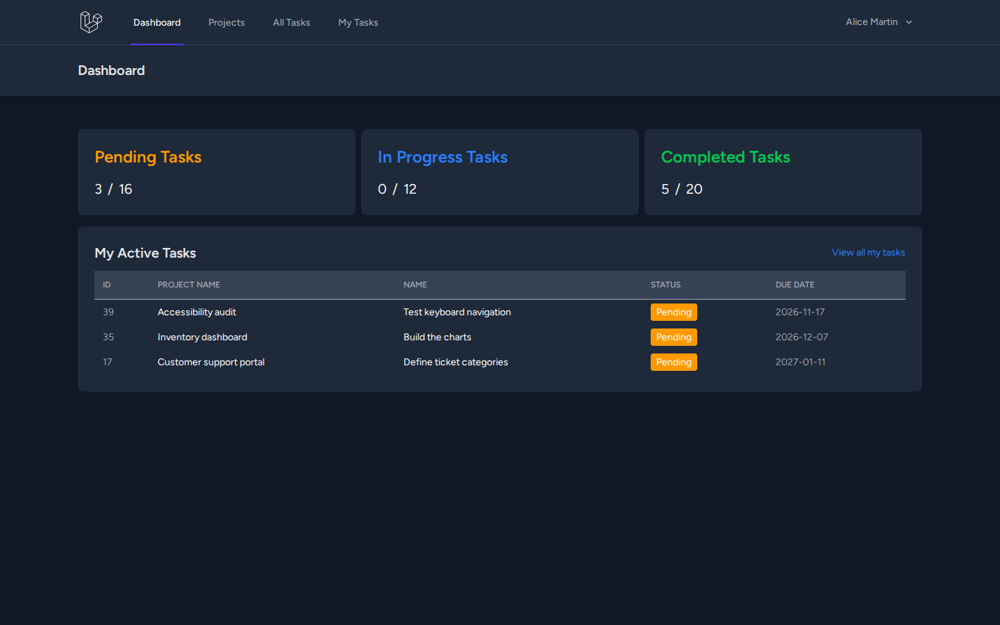
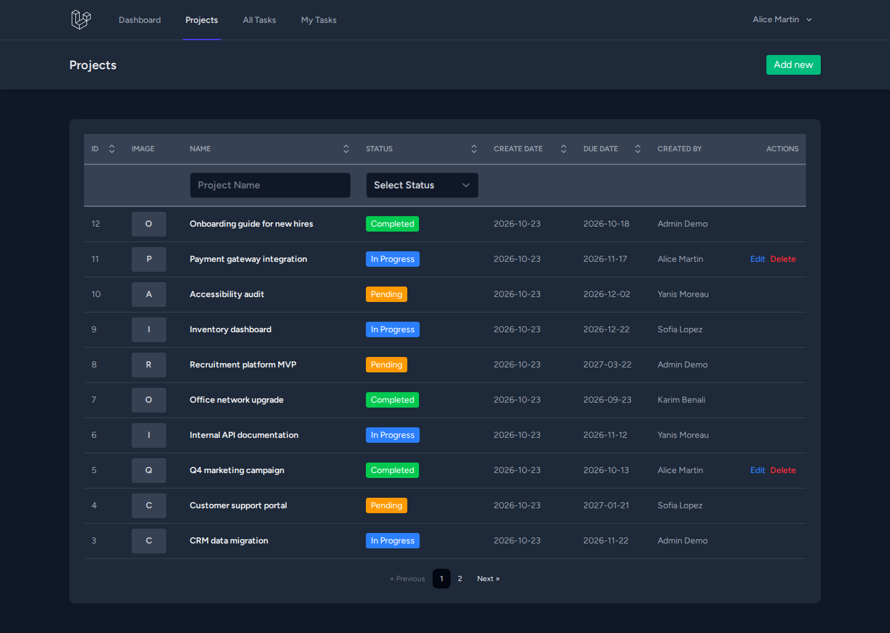
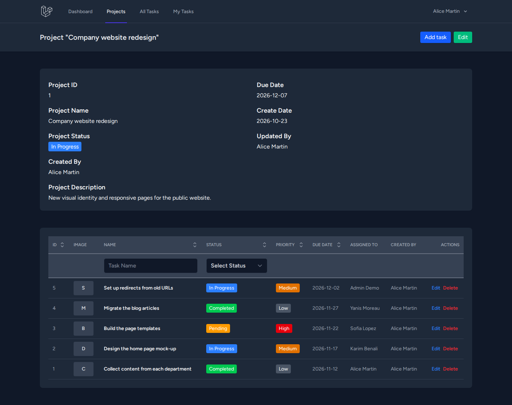
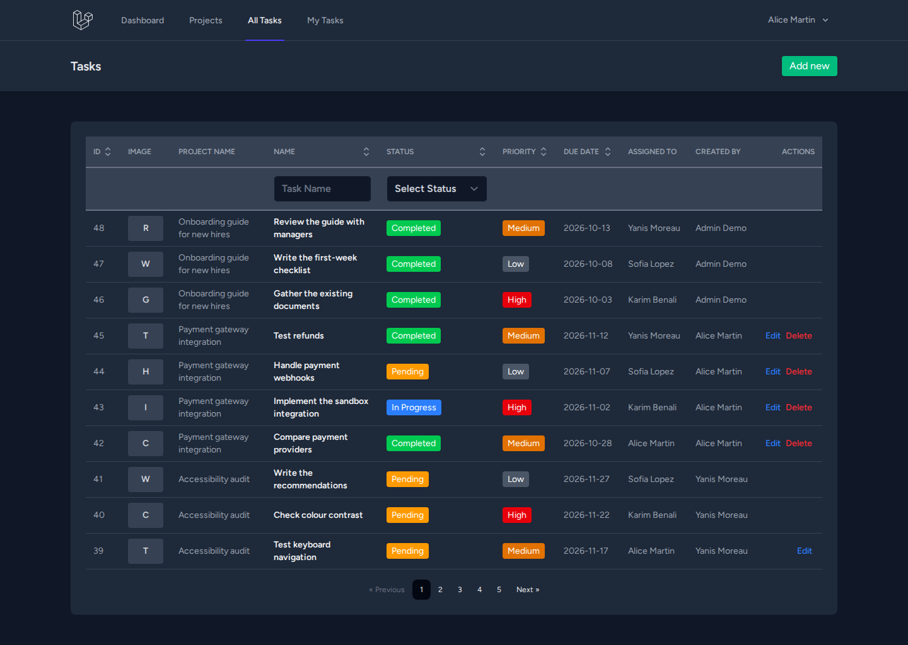
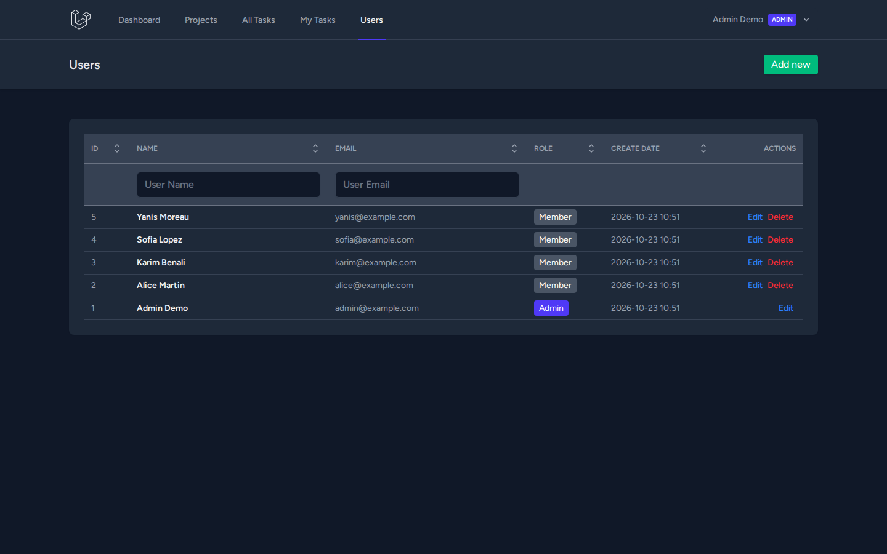

# Gestion de projets — Laravel · React · Inertia

Application web de gestion de projets et de tâches en équipe : tableau de bord, projets, tâches assignées, administration des comptes, avec un modèle d'autorisation testé.

[](https://github.com/blcoussama/LARAVEL-REACT-INERTIA/actions/workflows/ci.yml)



| Projets | Détail d'un projet et ses tâches |
|---|---|
|  |  |

| Tâches | Utilisateurs (administrateur) |
|---|---|
|  |  |

Captures réalisées sur l'application lancée en local avec les données de démonstration (comptes et projets fictifs). Les liens « Edit / Delete » n'apparaissent que là où l'utilisateur connecté en a le droit : sur la liste des projets, Alice ne peut modifier que ses propres projets.

## Fonctionnalités

- **Authentification** (Laravel Breeze) : inscription, connexion, vérification de l'adresse e-mail, mot de passe oublié, page de profil.
- **Tableau de bord** : nombre de tâches en attente / en cours / terminées (les miennes et le total) et liste de mes tâches actives.
- **Projets** : liste paginée avec filtres (nom, statut) et tri par colonne, page de détail avec les tâches du projet, création, modification, suppression, image facultative.
- **Tâches** : liste de toutes les tâches et page « My Tasks », priorité, échéance, personne assignée, image facultative ; ajout direct depuis la page d'un projet.
- **Utilisateurs** (administrateurs uniquement) : liste, fiche avec les tâches assignées, création, modification (rôle compris), suppression.
- Interface en mode sombre, en anglais.

## Modèle d'autorisation

Deux rôles : `member` (par défaut, y compris à l'inscription) et `admin`. Les règles sont dans `app/Policies/` et sont appliquées côté serveur (Policies, `authorize()` des FormRequest, `Gate::authorize()` dans les contrôleurs, middleware `can:` sur le module Utilisateurs). L'interface ne fait que masquer les boutons inutilisables, à partir des droits calculés par le serveur.

| Action | Membre | Administrateur |
|---|---|---|
| Consulter projets et tâches | oui (espace d'équipe partagé) | oui |
| Créer un projet | oui (il en devient le responsable) | oui |
| Modifier / supprimer un projet | seulement ses projets | tous |
| Créer une tâche | seulement dans ses projets | partout |
| Modifier une tâche | s'il l'a créée, en est l'assigné ou possède le projet | toutes |
| Déplacer une tâche vers un autre projet | seulement vers un projet qu'il possède | partout |
| Supprimer une tâche | s'il l'a créée ou possède le projet (pas l'assigné) | toutes |
| Module Utilisateurs | non (403) | oui, sauf changer son propre rôle ou supprimer son propre compte depuis ce module |

Pourquoi ce choix : le créateur d'un projet en est le responsable ; il planifie les tâches et les attribue. La personne assignée fait avancer sa tâche (statut, description) sans pouvoir la supprimer ni l'envoyer dans le projet de quelqu'un d'autre. L'administrateur gère les comptes. Le rôle et la date de vérification ne sont pas assignables en masse (`$fillable`), ce qui empêche de se donner le rôle `admin` via l'inscription ou le profil.

Le premier administrateur d'une installation réelle se crée en ligne de commande :

```bash
php artisan app:make-admin prenom.nom@exemple.org
```

## Stack

- **Back-end** : PHP 8.3+, Laravel 12, Laravel Breeze, Inertia.js (adaptateur Laravel 2), Ziggy
- **Front-end** : React 18, Inertia.js, Tailwind CSS 4, Headless UI, Heroicons, Vite 6
- **Base de données** : SQLite par défaut (testé aussi sur MySQL 8.4)
- **Tests** : Pest 3 (PHPUnit 11)
- **CI** : GitHub Actions

## Architecture

```
app/
├── Http/Controllers/          Dashboard, Project, Task, User (+ contrôleurs Breeze)
│   └── Concerns/              FiltersAndSortsTables : filtres et tri par liste blanche
├── Http/Requests/             validation + authorize() de chaque formulaire
├── Http/Resources/            données envoyées aux pages (droits "can" inclus)
├── Models/                    User (rôle), Project, Task
├── Policies/                  ProjectPolicy, TaskPolicy, UserPolicy
└── Support/ImageStorage.php   stockage / suppression des images
database/migrations/           schéma, rôle, clés étrangères ON DELETE
database/seeders/              données de démonstration fictives
resources/js/Pages/            pages React rendues par Inertia
routes/web.php                 routes protégées par auth + verified
tests/Feature/                 tests Pest (sécurité, suppression en cascade, pages)
```

Le serveur rend chaque page avec `inertia('Project/Index', [...])` ; Inertia charge le composant React correspondant (`resources/js/Pages/Project/Index.jsx`) avec ces données, sans API REST séparée.

## Installation et lancement en local

Prérequis : PHP 8.3+ (extensions `pdo_sqlite`, `mbstring`, `fileinfo`, `gd`), Composer 2, Node.js 20+ et npm.

```bash
git clone https://github.com/blcoussama/LARAVEL-REACT-INERTIA.git
cd LARAVEL-REACT-INERTIA

composer install
npm ci

cp .env.example .env          # SQLite par défaut
php artisan key:generate
touch database/database.sqlite
php artisan migrate --seed    # schéma + données de démonstration
php artisan storage:link      # rend les images envoyées accessibles

npm run build
php artisan serve             # http://127.0.0.1:8000
```

En développement, `composer run dev` lance en parallèle le serveur, la file d'attente, les logs et Vite (rechargement à chaud). Pour repartir de zéro : `php artisan migrate:fresh --seed`.

### Comptes de démonstration

Créés par `php artisan migrate --seed`. Tous les noms et adresses sont **fictifs** (`example.com` est un domaine réservé) et le mot de passe `password` est un mot de passe de démonstration : ne lancez pas ce seeder sur un serveur accessible depuis Internet.

| Compte | Rôle | Mot de passe |
|---|---|---|
| `admin@example.com` | admin | `password` |
| `alice@example.com`, `karim@example.com`, `sofia@example.com`, `yanis@example.com` | member | `password` |

### Variables d'environnement

Le fichier `.env.example` est celui de Laravel 12 ; les valeurs par défaut suffisent pour un essai local.

| Variable | Rôle | Valeur locale |
|---|---|---|
| `APP_NAME` | nom affiché dans le titre des pages | `Laravel` |
| `APP_KEY` | clé de chiffrement (sessions, cookies) | générée par `php artisan key:generate` |
| `APP_ENV`, `APP_DEBUG` | environnement, affichage des erreurs | `local`, `true` (mettre `production`, `false` en ligne) |
| `APP_URL` | URL publique, utilisée pour les liens d'images | `http://localhost` |
| `DB_CONNECTION`, `DB_DATABASE` | base de données | `sqlite`, `database/database.sqlite` |
| `DB_HOST`, `DB_PORT`, `DB_USERNAME`, `DB_PASSWORD` | uniquement pour MySQL / MariaDB | — |
| `MAIL_MAILER` | envoi des e-mails (vérification, mot de passe oublié) | `log` : les liens arrivent dans `storage/logs/laravel.log` |
| `SESSION_DRIVER`, `CACHE_STORE`, `QUEUE_CONNECTION` | sessions, cache, file d'attente | `database` |

## Tests

```bash
php artisan test
```

76 tests Pest (455 assertions), exécutés sur SQLite en mémoire et vérifiés aussi sur MySQL 8.4. Ils couvrent notamment :

- **attaques d'autorisation** : un membre ne peut ni ouvrir le module Utilisateurs, ni changer l'e-mail ou le mot de passe d'un autre compte, ni le supprimer, ni modifier ou supprimer le projet ou la tâche d'un autre, ni créer une tâche dans le projet d'un autre, ni s'attribuer le rôle `admin` (inscription, profil) ;
- **tri et filtres** : `sort_field=password`, colonne inconnue, direction invalide ou paramètres en tableau ne provoquent plus d'erreur 500 et n'atteignent pas la requête SQL ;
- **suppressions** : un projet supprimé emporte ses tâches et leurs images ; un utilisateur supprimé laisse ses projets et tâches sans auteur ni assigné, et les pages s'affichent toujours ;
- **envoi d'images** : plus de 2 Mo, PHP, SVG ou PDF refusés ;
- les pages principales, les données partagées avec le front-end et le seeder de démonstration.

La CI (`.github/workflows/ci.yml`) exécute à chaque push : `composer audit`, `npm audit --audit-level=high`, `npm run build`, migrations + seed sur SQLite et la suite de tests sous PHP 8.3 et 8.4.

## Sécurité

- Autorisation côté serveur sur chaque action (voir le tableau ci-dessus), avec des tests d'attaque pour chaque règle.
- Tri limité à une liste blanche de colonnes et de directions ; filtres limités aux valeurs connues.
- Images : `jpg`, `jpeg`, `png` ou `webp`, 2 Mo maximum ; chaque image dans un dossier aléatoire, supprimée avec son projet ou sa tâche.
- Données envoyées au navigateur réduites au nécessaire : l'utilisateur connecté (id, nom, e-mail, vérification, rôle) ; pour les auteurs et assignés, seulement l'id et le nom (pas l'e-mail).
- Pagination affichée en texte (plus de `dangerouslySetInnerHTML`).
- Clés étrangères avec `ON DELETE CASCADE` / `SET NULL` : plus d'erreur 500 à la suppression.
- Fonctions de Breeze conservées : CSRF, mots de passe hachés (bcrypt), limitation des tentatives de connexion, vérification de l'e-mail obligatoire.
- Dépendances à jour : `composer audit` et `npm audit` sans vulnérabilité connue (octobre 2026).

## Limites connues

- L'inscription est ouverte et tous les membres voient tous les projets (espace d'équipe unique) : pour une mise en ligne, il faudrait fermer l'inscription ou ajouter une notion d'équipe / de membres par projet.
- Un projet n'a qu'un responsable (son créateur) ; pas de co-responsables.
- Le formulaire de tâche charge la liste complète des utilisateurs (adapté à une petite équipe).
- Images stockées sur le disque local (`storage/app/public`).
- Interface uniquement en anglais ; pas de notifications ni de temps réel.
- L'application n'a pas été déployée : elle est prévue pour un usage local / de démonstration.

## Origine du projet

Projet d'apprentissage réalisé en suivant un tutoriel YouTube (application de gestion de projets avec Laravel, Inertia et React) : la structure de départ, les CRUD, les tableaux paginés avec filtres et tri et le tableau de bord en viennent.

### Ce que j'ai ajouté / corrigé

- **Faille critique corrigée** : il n'y avait aucune autorisation (tout compte vérifié pouvait changer l'e-mail et le mot de passe de n'importe quel utilisateur, le supprimer, modifier ou supprimer tous les projets et tâches). Ajout du rôle `admin`, de trois Policies, de vrais `authorize()`, d'un middleware sur le module Utilisateurs et de la commande `app:make-admin`.
- **Tri sécurisé** : `orderBy()` recevait directement les paramètres de l'URL ; remplacé par une liste blanche commune (trait `FiltersAndSortsTables`).
- **Suppressions** : nouvelle migration `ON DELETE CASCADE` / `SET NULL` (supprimer un projet qui avait des tâches, ou un utilisateur qui avait créé des projets, renvoyait une erreur 500) ; suppression des images devenues orphelines.
- **Build cassé réparé** : `npm run build` échouait (la page utilisateur importait un fichier inexistant) ; la page utilisateur, vide côté serveur, affiche maintenant la fiche et les tâches assignées.
- **Bugs d'interface** : lien « My Tasks » ajouté (menu bureau et mobile) ; les filtres et le tri du tableau des tâches renvoyaient toujours vers la liste générale, même depuis un projet ; les listes « statut » des formulaires de modification n'affichaient pas la valeur enregistrée ; erreurs de validation du statut jamais affichées ; une échéance vide s'affichait comme la date du jour ; images absentes affichées comme des images cassées.
- **Validation des images** (taille, types) et données partagées avec React limitées au nécessaire.
- **Mode sombre** complété sur tous les composants Breeze (barre de navigation, formulaires, profil, authentification).
- **Données de démonstration** fictives et factories corrigées (elles supposaient un utilisateur n° 1 et des images hébergées sur un service externe).
- **76 tests Pest** ajoutés ou corrigés (le test d'exemple échouait sur la redirection de `/`), **CI GitHub Actions**, ce README.
- **Dépendances** : Laravel 12.19 → 12.70 et migration vers Tailwind CSS 4 ; `composer audit` passe de 48 alertes à 0 et `npm audit` de 25 à 0.
